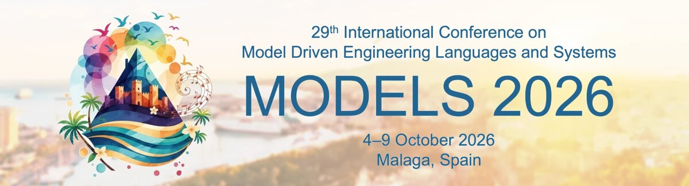
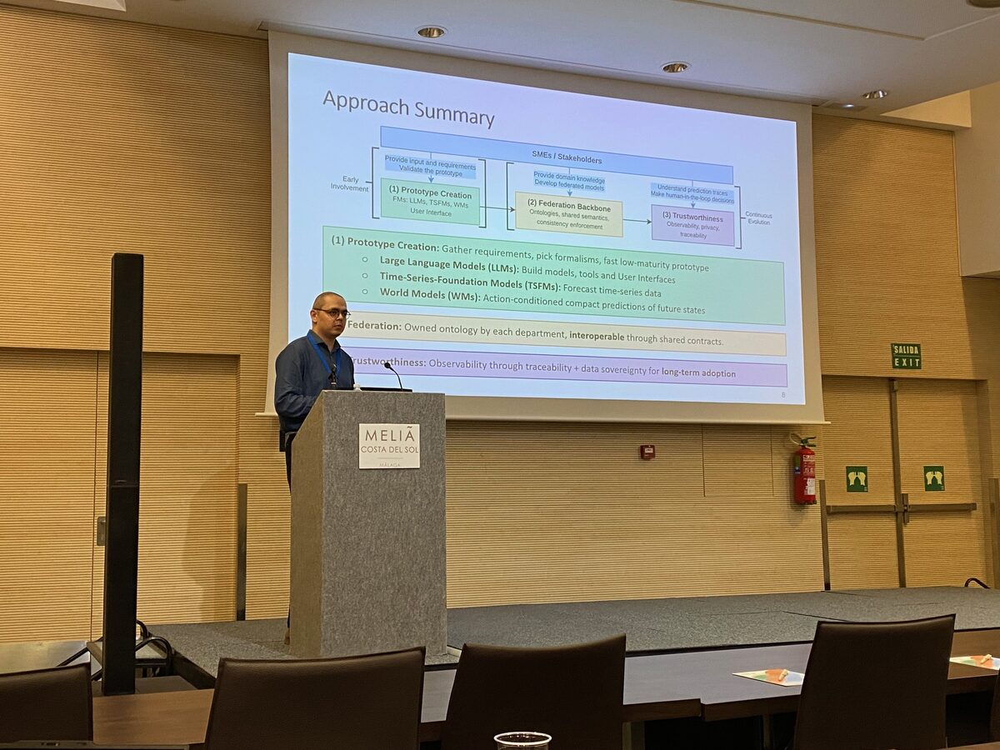
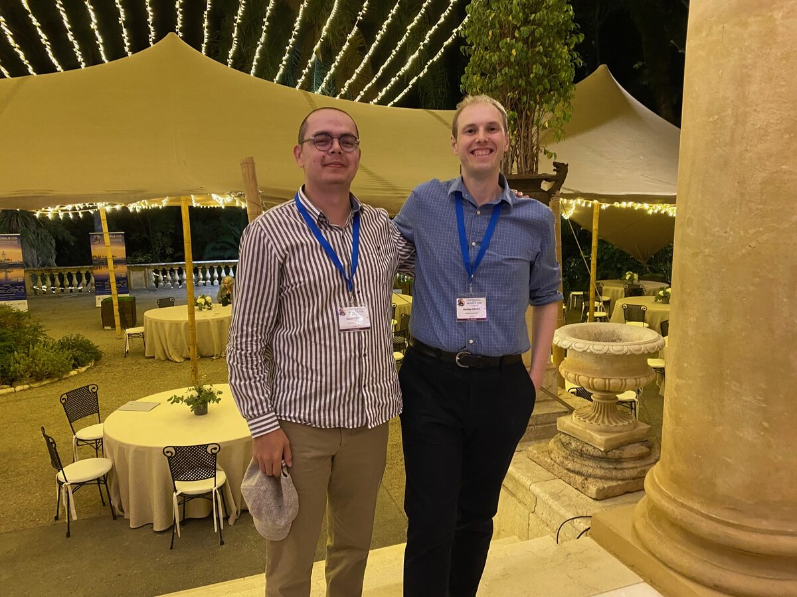
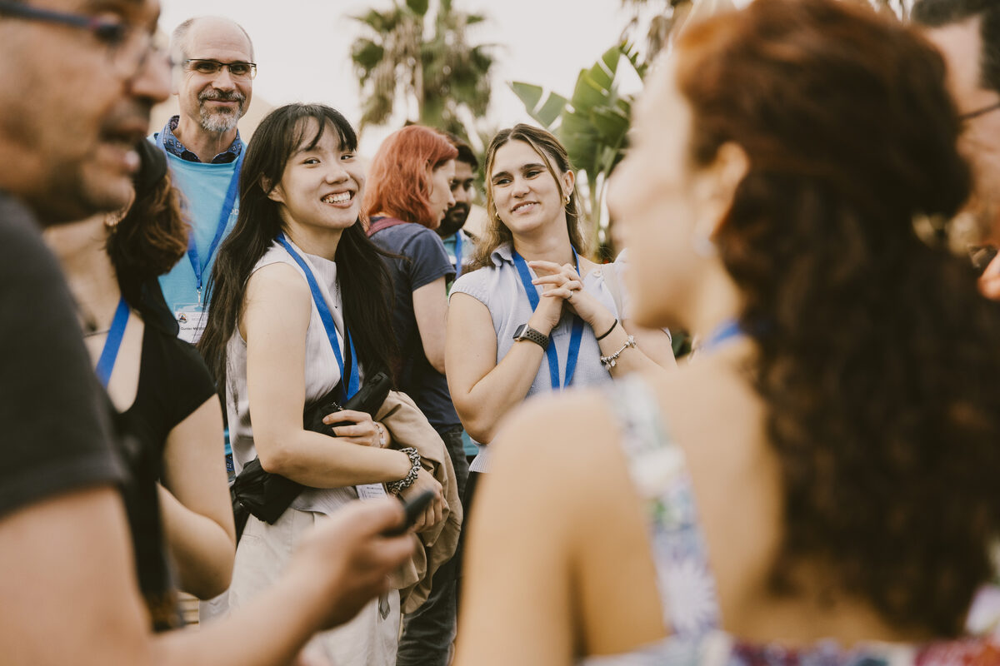
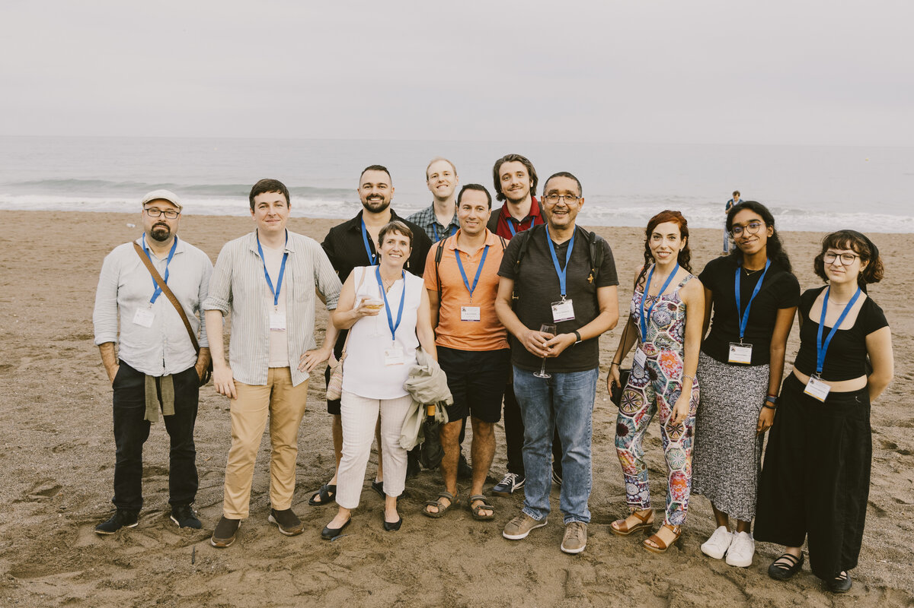

I had a fantastic week at the [ACM/IEEE International Conference on Model Driven Engineering Languages and Systems (MODELS 2026)](https://conf.researchr.org/home/models-2026) and the co-located [International Conference on Engineering Digital Twins (EDTconf 2026)](https://conf.researchr.org/home/edtconf-2026), held from 4 to 9 October in Málaga, Spain. It was a busy week for the lab, with a Best Short Paper award, two talks, a tutorial, and student volunteering.

<figure class="figure-full">
  
</figure>

One of my favourite parts of conferences is the feeling of community. I've been to MODELS many times, so I've come to know some faces and names. It's rewarding to see students being welcomed into the community too. At first, students know these people only as names in the related work section of a paper. But then they have the opportunity to meet these people in person and talk with them.

As at MODELS 2025, I'm proud that my students are contributing back to the community, not only through talks and tutorials, but also through organizing and volunteering.

## Contributing through work

Kérian Fiter's paper [Involving before Evolving: A Vision for Trustworthy Enterprise Digital Twin Engineering](/publications/edtconf-2026-enterprise-digital-twins/) won the **Best Short Paper** award at EDTconf. Kérian wrote the paper with Adil Lagrou, Franck Dervault (Michelin), and me, and presented it in Málaga.

<figure class="figure-narrow">
  
  <figcaption class="caption">Kérian Fiter presenting our Best Short Paper at EDTconf 2026.</figcaption>
</figure>

On Tuesday, I presented our vision paper [BRIC-DT: Building Reliable Interfaces for Composable Digital Twins](/publications/edtconf-2026-bric-dt-composable-digital-twins/), led by Cláudio Gomes (Aarhus University). That afternoon, Kérian led our MODELS tutorial, _“Promoting Observability in Digital Twin Reporting: A Hands-On Tutorial for DTInsight”_, and did an excellent job. It was rewarding to see Kérian share his knowledge with the community and help the participants.

<figure class="figure-narrow">
  
  <figcaption class="caption">Kérian Fiter and me at the MODELS 2026 banquet.</figcaption>
</figure>

## Contributing through service

Gabrielle Gallant did exceptional work as a student volunteer, such as being one of the most efficient people at the registration desk. I received many comments about how active and helpful she was, and her energy made a difference for attendees.

<figure class="figure-narrow">
  
  <figcaption class="caption">Sharon Liu (McMaster University) and Gabrielle chatting with other attendees.</figcaption>
</figure>

I co-organized the [onto:Nexus Workshop 2026](https://www.opencaesar.io/events/onto-Nexus-Workshop-2026) (International Workshop on Ontological Modeling and Analysis) with Maged Elaasar (Chair), Wahab Hamou-Lhadj, Mohammad Hamdaqa, and Eduard Kamburjan. In the afternoon, we had an active discussion on how to move ontological model-based systems engineering forward, and how to work on it together.

I also served on the MODELS 2026 Artifact Evaluation Track Program Committee, and I'm looking forward to [MODELS 2027](https://conf.researchr.org/home/models-2027) in Budapest, where I'm Publicity Co-Chair.

## An academic family

One thing I often tell my students is that they are an academic family with those around them. Istvan David, Cláudio Gomes, Eugene Syriani, and I were all students of Hans Vangheluwe. Gabrielle in particular was delighted to learn she is an academic cousin to the GEODES students from UdeM and to Xiaoran (Sharon) Liu from McMaster University. Sharon and Gabrielle became good friends during the week.

It was great to meet old and new friends during the week, including Mikkel Schmidt Andersen (Aarhus University), my academic nephew, who was a research intern in the lab in 2025. It's always a pleasure to be with the GEODES lab, who are a strong presence at MODELS every year.

<figure class="figure-narrow">
  
  <figcaption class="caption">Current and former GEODES members on the beach.</figcaption>
</figure>

## Thanks

Finally, thank you to Lola Burgueño (University of Málaga), the General Chair of MODELS 2026, for navigating the logistical and other challenges of organizing the conference. Thank you also to the EDTconf Program Co-Chairs, Nelly Bencomo, Eduard Kamburjan, and Vinay Kulkarni, to Cláudio Gomes for leading the BRIC-DT paper, and to Franck Dervault and Michelin for our collaboration.
